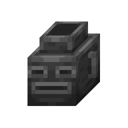

<div align="center">



# Deeper Dark

A mod inspired by EightSidedSquare's Deeper Dark showcased on Content SMP. 

(basically a full recreation + extras because I'm an impatient as fuck) 


</div>

---

## Features

### Screaming vases
Rotund, turgid and gaunt vases sit on ancient city floors and the bare deepslate around them, in small, mixed, spread out groups.

- **Break one and it screams.** The shriek sends vibrations to the natural vases nearby, which scream in turn, so a careless swing can set off a chain across the room.
- **Sensors and shriekers hear it too.** Every idle sculk sensor and shrieker within 12 blocks gets a vibration and goes off when it lands. Shriekers warn the player who started it.
- **Fragile.** A pickaxe breaks a vase instantly, and anything you throw at one shatters it (snowballs, arrows, eggs, tridents...).
- **Loot.** Natural vases hold ancient city loot. Silk touch lets you take one home, but it still screams on the way out. Once placed, it's just decoration.
- **Custom ceramic sounds** for shattering and placing.

### Sculk orifice
A mouth in the sculk floor. It breathes while it waits and snaps shut on anything that steps in, with evoker fang crunches.

### Sculk capacitor
A glass jar of sculk charge that you can see fill up.

- Found on top of sculk catalysts in the deep dark, already partly charged.
- Put one on a catalyst and kills nearby charge the capacitor instead of spreading sculk.
- Power it, for example with a lever, to pour its charge into the catalyst. It crumbles once it's empty.
- Only silk touch picks it up with its charge intact. Break it any other way and all of its charge bursts out as sculk.
- **Containment:** build a closed border on the floor around it (cobblestone, planks, glass, fences...) and the sculk stays inside.

### Particles
Vanilla-style particles out of the box. With LodestoneLib installed, the scream ring glows. Turn on **Lodestone Particles** in Mod Menu to swap in the full effects:
- braided, glowing smoke curling out of natural vases
- a crisp ring of light and escaping souls when one screams
- orbiting motes and soul streams on capacitors

---

## Installation

Drop `deeperdark-<version>.jar` into your `mods` folder along with the required mods.

### Required

| Mod | Version | |
| --- | --- | --- |
| [Minecraft](https://www.minecraft.net/) | 1.19.2 | |
| [Fabric Loader](https://fabricmc.net/use/) | 0.14.9+ | or [Quilt Loader](https://quiltmc.org/install/) |
| [Fabric API](https://modrinth.com/mod/fabric-api) | 0.60.0+ | or [Quilted Fabric API](https://modrinth.com/mod/qsl) on Quilt |
| Java | 17+ | |

### Optional

| Mod | What it adds |
| --- | --- |
| [Mod Menu](https://modrinth.com/mod/modmenu) | The config screen (4.1.2+ for 1.19.2) |
| [LodestoneLib (Quilt port)](https://github.com/Arathain/LodestoneLib-Quilt) | Glowing scream ring and the full Lodestone particle effects |
| [Rat's Mischief](https://modrinth.com/mod/rats-mischief) | Vases can hold a clothed ingot |

> [!NOTE]
> LodestoneLib for 1.19.2 is only made for Quilt. It needs **Quilt Loader** and **Quilted Fabric API**, so the Lodestone particles only work on Quilt. On Fabric, Deeper Dark sticks to its vanilla-style particles.

---

## Configuration

Open Deeper Dark's page in **Mod Menu** and click the config button, or edit `config/deeper_dark.json`:

```json
{
  "lodestoneParticles": false
}
```

`lodestoneParticles` switches to the LodestoneLib effects. It's off by default and greyed out when LodestoneLib isn't installed.

---

## Building

You need JDK 17.

```bash
./gradlew build
```

The jar ends up in `build/libs/`. Mod Menu and LodestoneLib are compile-only dependencies and aren't bundled.

---

## Credits

- **Chanwoo**: author
- **Nullioner**: textures
- **EightSidedSquare**: the original mod and inspiration

Source: [github.com/4chanwoo/DeeperDark](https://github.com/4chanwoo/DeeperDark). Issues and ideas welcome.
